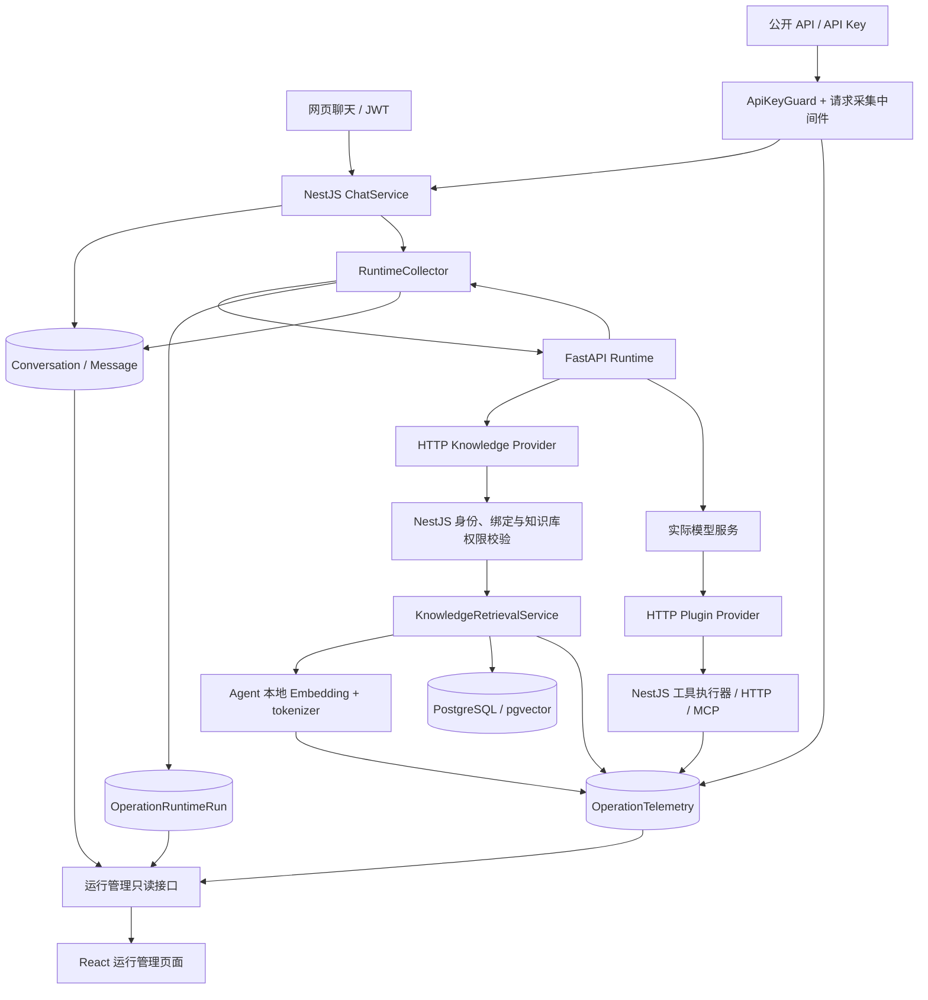
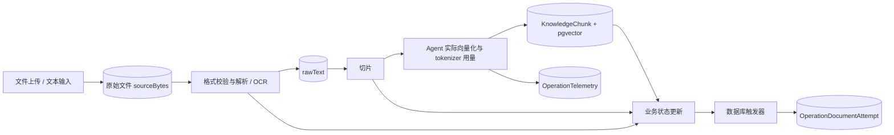

# 运行管理真实数据链路

日期：2026-11-27。范围：运行概览、Agent 聊天、知识库、集成与调用。所有读取均限定当前登录用户及其资源；生产页面不再依赖 `operations.mock.ts`，该文件仅被测试引用。

## 页面、接口与真实来源

| 页面/字段 | 读取接口 | 写入/计算来源 | 数据口径 |
| --- | --- | --- | --- |
| 累计/峰值 Token | `GET /api/operations/runtime/stats` | `OperationRuntimeRun` 聚合 | 供应商实际报告的完整用量；缺报运行另计，零调用显示 0 |
| Token 热力图、智能体/会话统计 | `GET /api/operations/runtime/runs`，完整分页读取 | 同一批真实运行记录 | 不再只统计首批 100 条；按 ID 去重；24 小时/7 天/30 天在完整记录上筛选 |
| 首页最新运行与今日错误 | 上述运行接口 + 知识库文件目录接口 | `OperationRuntimeRun`、`KnowledgeDocument`、最新 `OperationDocumentAttempt` | 同时纳入实际聊天和文件处理，文件错误使用处理终态时间/文档更新时间 |
| 会话目录、完整正文 | `/api/operations/agents/:id/conversations`、`/api/operations/conversations/:id/messages` | `Conversation`、`Message` | 完整翻页；没有历史执行采集的消息仍可看正文，不虚构执行链路 |
| 会话来源 | 运行记录的 `source`、`apiKeyId` | Web 默认为 `web`；公开 API 由请求上下文提供已验证的 Key ID | 混合来源独立标记；旧记录未存来源时显示历史未记录，不从 stream/run 猜渠道 |
| 执行链路与节点异常 | `/api/operations/runtime/runs/:id` | Runtime 阶段与事件 + 同一 runId 的检索/工具日志 | 实际耗时、首字响应、每轮模型用量、工具参数/结果、检索候选/引用；工具失败但回答成功标为“完成，有异常” |
| 当前上下文/记忆 | `/api/conversations/:id/memory` → `/internal/runtime/context/preview` | ChatService 历史摘要与近期原文 + Runtime 实际预算预览函数 | 当前配置下的下一轮基础上下文预览；Token 是明确标注的保守估算，区别于模型实际用量 |
| 知识库容量、文件类型/状态/切片数 | `/api/operations/knowledge-bases`、`/knowledge-bases/:id/documents` | `KnowledgeBase`、`KnowledgeDocument`、`KnowledgeChunk` | 原文件大小由 PostgreSQL `octet_length(sourceBytes)` 计算；缺失大小不使用占位容量 |
| 原文件、解析文本、切片 | `/api/documents/:id/file`、运行管理的 `/text`、知识库的 `/chunks` | 原始 `sourceBytes`、`rawText`、实际切片行 | PDF/图片预览访问真实文件；其他格式查看实际解析文本；停用知识库仍可只读切片，不能参与检索 |
| 文件处理历史/阶段耗时 | `/api/operations/knowledge-bases/:id/documents/:documentId/attempts`，目录同时带最新一次记录 | `OperationDocumentAttempt` 数据库触发器 | 每次处理保留独立记录。阶段耗时按进入/离开时间差计算，未知旧时间不推算 |
| 知识库 Token 趋势 | `/api/operations/knowledge-bases/:id/activity` | `OperationTelemetry(kind=embedding)` | Agent 的实际 tokenizer 计数，含文件索引和检索问题向量化；本地 Token 不是模型供应商费用 |
| 知识库检索记录 | 同上 `/activity` | `OperationTelemetry(kind=retrieval)` + Runtime 实际 citations | 包含检索测试、聊天检索、候选正文/相似度、命中/失败、耗时和实际采用情况；流式引用事件与非流式最终结果均支持 |
| 集成资源概览 | `/api/operations/resources` | 本人绑定的插件、本人的工作流/API Key/模型配置 | 插件目录是共享资源，仅统计本人智能体绑定的项；最近连接状态不是后台持续探测 |
| API 请求与按 Key 汇总 | `/api/operations/integrations/activity` | `OperationTelemetry(kind=api)` | 真实 HTTP 状态、Runtime 结果、耗时、中断、Key ID、runId；HTTP 200 中的 Runtime 失败仍算失败 |
| 插件调用列表 | 同上 | 新调用：`OperationTelemetry(kind=tool)`；旧调用：Runtime 工具事件 | 新旧来源去重。新调用有脱敏输入/输出、状态、耗时及关联会话；旧参数未保存时明确显示未记录 |
| 工作流运行明细 | 同上 | `WorkflowRun` 的 input/output/nodeResults/error/时间 | 读取执行时保存的节点结果，不用当前编辑器草稿替代旧运行结果；输入输出按现有规则脱敏、限长 |

## 聊天、知识检索与插件调用

1. ChatService 验证归属与附件，按智能体原文轮数和预算将较早对话增量压缩为会话摘要；完成后在事务中保存本轮消息，再携带历史摘要与近期问答调用 Runtime。原始消息不会删除，详见 [上下文压缩改造](conversation-context-compression.md)。
2. Collector 在实际调用前创建运行记录，公开 API 的来源和 Key ID 从服务器验证过的请求上下文取得，不信任浏览器传入的归属信息。
3. Runtime 检索时，NestJS 先验证用户、智能体、绑定和知识库范围。检索问题实际向量化，再查询 pgvector；记录候选、相似度、耗时和结果。
4. Runtime 完成上下文组装后使用实际模型。工具调用进入现有执行器，运行管理另存经脱敏的参数与实际结果。
5. 最终用量、阶段和过程事件进入运行记录。多轮调用只要有一轮未报告 usage，就不把部分和当作整轮总量；已知的分轮用量仍在阶段详情中显示。
6. 会话消息保存状态与 Runtime 结果分别呈现，避免模型完成但消息保存失败时仍显示全面成功。
7. API 中间件在响应完成或断开后记录一次请求，并通过同一上下文关联 runId。HTTP 状态、Runtime 结果与消息保存后的业务结果分别记录；流式中断、模型完成但消息保存失败都不会被统计为成功。耗时在响应结束时取值，不包括之后用于确认归属的数据库查询。原始 Key、Authorization、Cookie、请求正文都不进入该请求日志。撤销密钥产生的 401 可通过哈希确认归属；完全未知的无效 Key 不归给任意用户。

## 知识库文件处理

重试复用业务接口，原记录不会被新结果覆盖。处理失败时保留实际失败阶段。删除仍受业务状态检查，处理中禁止删除。文件下载和预览再次验证知识库归属；HTML 不以内联页面执行。

阶段计时覆盖资料入库后的处理，不能冒充浏览器上传网络耗时。旧快照没有开始时间时，只展示已知状态和观测时间。

## 工作流与集成

工作流编辑器 → `POST /api/workflows/:id/run` → Agent 工作流执行器 → 保存 `WorkflowRun` 的执行定义、输入、输出、节点结果、错误和起止时间 → 运行管理集成接口 → “工作流执行”标签。

工作流总超时使用实际触发的超时上下文判断，不依赖定时器唤醒后的时钟比较；修正了 Windows 下总超时偶尔误标为模型超时的错误归因。

“插件与外部服务”“模型服务”“对外 API/SDK”分别管理出站业务服务、模型供应商和本项目对外访问权限。它们的凭据、调用含义和权限边界不同，不合并存储或展示密钥明文。

## 刷新与历史边界

- 页面首次打开、重新可见、窗口重新聚焦和手动刷新都会读取接口；观察到运行中任务时每 5 秒刷新，否则每 30 秒刷新；隐藏页面停止定时刷新。
- 集成和检索明细有服务端分页。聊天统计读取完整分页数据，不将首批一百条当作全部运行。
- 文档阶段触发器已有历史可直接读取；从未采集过的精确时间、Key 归因、Token、工具参数不能可靠还原，显示历史未记录。
- 知识库趋势记录本次接通后的实际向量化请求。多库共享同一次检索向量化时，每个参与库可看到整次请求用量，不能相加视为全平台费用。
- 无事件时展示真实空态/零条记录，不补示例数据。供应商不返回 usage 时展示缺报，不用字符数伪造实际 Token。

## 已执行的真实验收

隔离的临时业务资源通过正常 HTTP 业务接口创建，验收后已清理，没有混入用户原有业务统计。

- 文件上传、解析、向量化、原文件下载、越权拒绝、失败重试和确认删除通过。
- 知识库检索测试与聊天检索均能回读日志；本轮向量化实际输入共 78 Token。
- 一次完整真实模型调用（含工具回合）报告 567 Token；完成 `echo_text` 工具调用，参数、结果及一条实际采用的知识片段可回读。
- API 两次已归属请求分别为真实成功调用与撤销 Key 后的 401，可按 Key 统计，运行来源为 `api`，关联到实际 runId。
- 两节点工作流真实执行成功，两个节点结果进入运行管理；一轮会话记忆成功回读。
- 运行管理桌面/手机页面、文件管理操作和引用采用情况已通过浏览器与真实接口联调。

迁移：`20261127170000_operations_live_telemetry` 新增采集表和 Runtime 来源/Key ID 字段；已有数据没有被伪造回填。没有新增第三方依赖。
