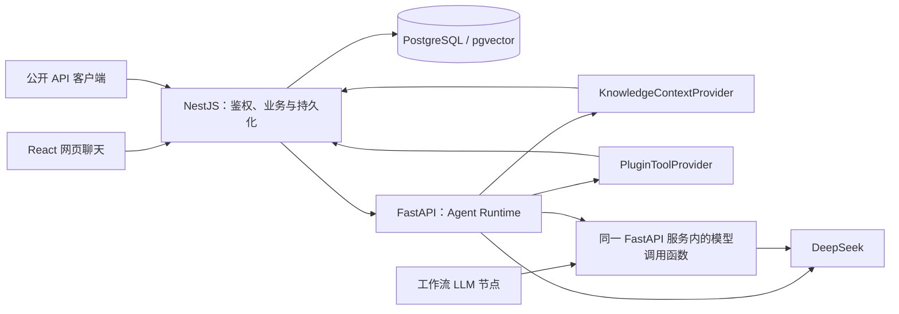
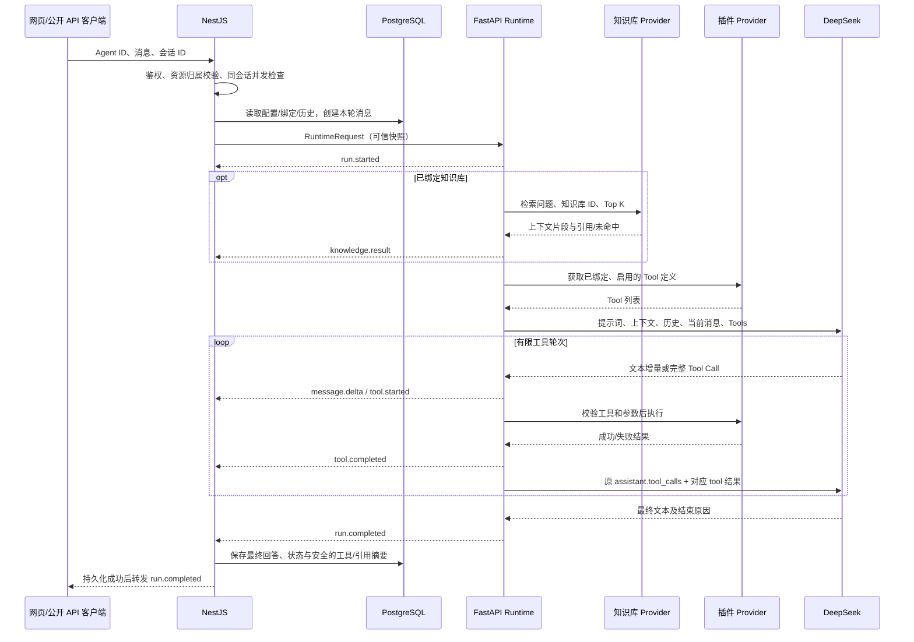
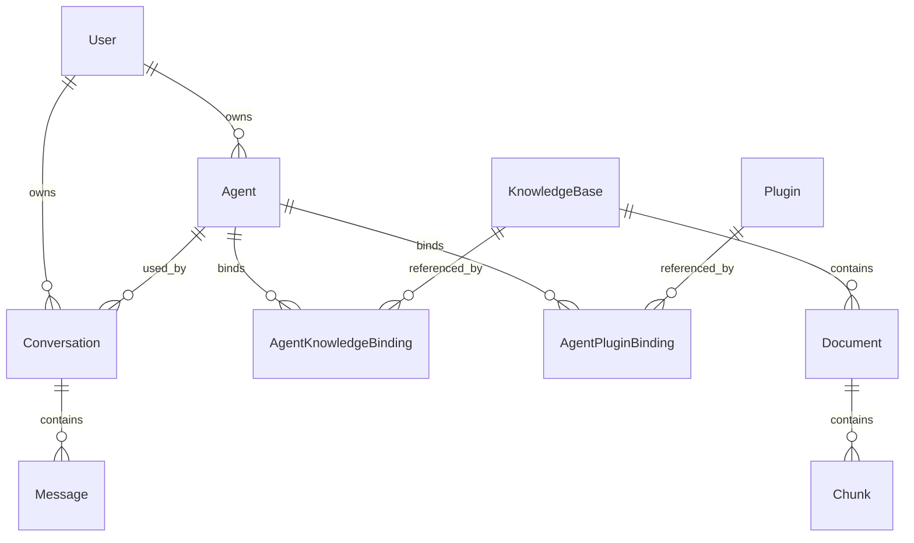

# MiniCoze Week 1 个人工作文档｜王一恒：Agent Runtime

> 编写日期：2026-10-11。依据：飞书《MiniCoze 的 MVP 实施方案》revision 822 中的 Week 1、个人工作链路和分工协调内容。
> 修订日期：2026-10-13。补充完整功能流程、基础 UI 线框、字段及实体关系、请求/返回示例、异常交互和跨模块联调验收点。
> 记忆设计补充：2026-10-18。短期记忆按 Runtime 与聊天模块的既有职责细化；长期记忆仅补充跨模块设计提案，是否进入 MVP 及负责人尚待组长确认，不代表功能已实现或契约已冻结。
> 文档性质：设计与契约评审稿。下文“建议”均为本次设计方案，尚未经其他成员确认，不代表团队已冻结，也不代表功能已实现。

## 1. 本周产出与实际进度

负责人：王一恒（组员 2）。职责：DeepSeek 调用、run/stream、上下文组装、知识库上下文接入、插件 Tool Call 循环和统一运行事件。

第一周以调研、体验、设计和契约冻结为主，不进行正式功能开发。本次已形成以下文档产出：

| 要求 | 本文对应产出 | 状态 |
| --- | --- | --- |
| 完整功能流程 | 第 2.3 节：前置条件、主流程、分支与完成条件 | 已形成设计稿 |
| 数据结构 | 第 4.3 节：实体关系、字段含义、持久化归属 | 待数据负责人评审 |
| 请求与返回格式 | 第 4.4、7.3 节：HTTP、SSE、Provider、工作流样例 | 已形成契约草案 |
| Runtime 时序图 | 第 3 节：聊天、RAG、工具调用与结果保存链路 | 已形成设计稿 |
| 接口定义 | 第 4、7 节：run/stream、模型调用、知识库与插件契约 | 待相关负责人评审 |
| 流式事件 | 第 5 节：事件类型、字段、顺序与终止规则 | 待与韦淇元确认 |
| 错误约定 | 第 8 节：校验、模型、检索、工具及中断处理 | 待跨模块确认 |
| UI 配合方案 | 第 9 节：聊天与工具调用状态映射 | 待聊天负责人确认 |
| 环境与运行方案 | 第 10 节：已有启动方式与新增变量建议 | 骨架配置已核对；新增配置未实现 |
| 调研样例与体验 | 第 11 节：DeepSeek 样例及验收记录要求 | 尚未真实调用模型或体验 Coze |

已核对当前 README、架构文档、Agent 配置和依赖、公共类型、NestJS 错误过滤器。仓库目前仅有应用骨架与健康检查；`apps/agent/app/runtime/__init__.py` 为占位入口，`packages/shared/src/index.ts` 仅有 `HealthResponse`。本文不能作为业务功能已完成或模型样例已跑通的证明。

## 2. 模块范围与技术边界

### 2.1 最小闭环

接收用户消息和 Agent ID → NestJS 鉴权并读取配置/历史 → Runtime 获取知识库上下文与可用工具 → 调用 DeepSeek → 按需执行工具并继续生成 → 返回统一事件 → NestJS 保存结果并提供给网页聊天或公开 API。

Runtime 本期覆盖普通文本对话、流式生成、有限历史、绑定知识库检索、已绑定插件工具调用，以及给工作流 LLM 节点复用的单次模型调用。

本方案不增加多 Agent 协作、后台任务队列、任意代码执行、自动重连续传或并行工具调度。短期记忆由 Runtime 消费历史与聊天模块存取历史共同完成；长期记忆的 Runtime 消费方案见第 6.5 节，尚未纳入已冻结的 MVP 实现范围。登录/OAuth、聊天页面、数据库持久化、发布/API Key、知识库入库、插件市场及工作流画布由对应负责人设计实现。

### 2.2 调用方向



- 浏览器和公开客户端只调用 NestJS，不直接访问 FastAPI。
- NestJS 是 PostgreSQL/pgvector 的唯一访问入口，负责用户、Agent、会话和绑定资源的权限检查。
- FastAPI 接收 NestJS 已解析的配置和历史，不直接访问数据库，不自行实现登录或公开 API Key 认证。
- 检索计算可由 Python 知识模块完成；向量数据读写仍经 NestJS 的受控接口。Runtime 仅依赖检索输入输出契约。
- 内部 HTTP 调用建议使用服务凭证，并在部署网络中限制访问；CORS 不是服务间鉴权。凭证方案需组长确认。

### 2.3 完整功能流程

前置条件：用户已登录并有权访问 Agent；公开调用方持有有效 API Key，且该渠道已发布。Agent 有合法模型配置，选用的知识库和插件属于可访问且可用的资源。

| 步骤 | 用户动作/系统处理 | 可见结果与数据变化 |
| --- | --- | --- |
| 1. 进入聊天 | 用户从 Agent 列表进入聊天页，选择已有会话或新建会话 | 展示 Agent 名称、已有历史或空态；未登录进入登录页 |
| 2. 输入消息 | 用户输入非空文本并发送 | 展示用户消息和助手占位气泡；输入为空时不能发送 |
| 3. 校验并建轮次 | NestJS 校验身份、Agent/会话归属、消息限额及并发；新会话先创建 Conversation | 生成 runId 和消息 ID，保存用户消息及 running 助手占位记录；校验失败不调用 Runtime |
| 4. 准备上下文 | NestJS 读取配置快照和完成的历史；Runtime 按绑定关系获取知识上下文和工具 | 展示正在生成；检索命中展示来源，未命中说明无相关资料 |
| 5. 生成回答 | Runtime 调用模型，转发用户可见文本增量 | 助手气泡逐步更新，可点击停止 |
| 6. 按需调用工具 | 模型请求工具时先验证，再串行执行，追加对应结果并继续生成 | 展示工具执行中/成功/失败卡片；工具失败不会伪装为成功 |
| 7. 完成本轮 | Runtime 返回最终内容；NestJS 保存 completed 状态、引用和安全工具摘要后发完成事件 | 停止 loading，恢复发送；达到长度限制时显示截断提示 |
| 8. 继续或查看历史 | 用户发送下一条消息，或离开后再次进入会话 | 下一轮使用已完成的历史；重新进入显示持久化内容及本轮状态 |

分支与退出条件：

- 无知识库或插件绑定：直接以提示词、历史和当前消息调用模型，无需展示空的工具卡片。
- 新会话与已有会话：客户端新会话省略 conversationId；已有会话必须与当前用户及 Agent 匹配，不能通过修改 ID 访问他人历史。
- 停止生成：用户点击停止，终止响应读取并向服务端传播取消；保留部分回答，显示“已停止”，不参与完成回答的历史组装。
- 发生终止性错误：保留部分回答和已有工具状态，显示失败原因；用户可修改输入后主动重试，产生新的 runId。
- 切换 Agent：结束当前流，进入所选 Agent 的会话；不把原会话历史自动带到另一个 Agent。
- 公开 API：调用方提交消息 → NestJS 验证发布渠道/API Key → 使用发布配置快照 → 进入相同 Runtime 流程；不依赖网页登录态。
- 工作流 LLM 节点：工作流校验并组装节点输入 → 调用单次模型能力 → 返回节点输出或错误 → 执行器决定继续/终止；不创建聊天消息。

完成条件：成功得到唯一完成事件且最终结果已保存；失败、取消、未收到终止事件的断流都不算本轮成功。第一周对以上流程做设计评审，后续开发周再做真实流程联调。

## 3. Runtime 时序图



普通文本增量由 NestJS 随到随转发。示意图省略逐个增量的转发箭头。Runtime 失败时发送 `run.failed`；客户端中断时取消上游请求并释放资源。NestJS 必须在向客户端宣布完成前确认最终保存成功；保存失败需要转换为对外失败，不能宣称本轮成功。

## 4. 请求、数据结构与 run/stream 接口

### 4.1 身份与配置

以下 TypeScript 表达的是 JSON 契约草案；Python 端后续以 Pydantic 校验同一字段。未冻结前不写入公共类型包。

```typescript
type JsonValue = null | boolean | number | string | JsonValue[]
  | { [key: string]: JsonValue };

interface CurrentUser {
  id: string;
}

interface AgentConfig {
  id: string;
  revision: number;
  name: string;
  systemPrompt: string;
  model: string;
  temperature: number;
  maxTokens: number;
  knowledgeBaseIds: string[];
  pluginIds: string[];
}

interface HistoryMessage {
  id: string;
  role: 'user' | 'assistant';
  content: string;
}

interface RuntimeRequest {
  runId: string;
  actor: CurrentUser;
  conversationId: string;
  userMessageId: string;
  assistantMessageId: string;
  agentConfig: AgentConfig;
  history: HistoryMessage[];
  message: string;
}
```

约束：

- `actor.id` 由 NestJS 从登录态或 API Key 对应所有者解析，禁止相信客户端提交的用户 ID。
- `agentConfig` 由 NestJS 读取草稿或发布配置快照；公开 API 的发布快照规则由陈弘毅、韦淇元确认。
- `revision` 标识一次配置快照；运行期间编辑 Agent 不改变当前调用的参数。现有仓库尚无该字段实现。
- `history` 按时间升序，只包含已完成的普通 user/assistant 对话，不包含本轮用户消息，避免重复拼接。本期不跨轮重放历史工具消息。
- 所有 ID 采用不透明字符串，HTTP DTO 使用 camelCase，Python 内部字段可使用别名映射；时间使用 UTC ISO 8601。
- 模型名称由后端允许列表和运行环境确认；不依赖旧模型别名永久有效。参数范围按实际所选模型校验。
- 建议最初限额：当前消息最多 8,000 字符、历史最多 20 条、RAG 文本最多 12,000 字符。字符限制仅防超大请求，不能替代模型 token 预算；超出预算先移除最旧完整对话对，再裁剪检索片段，仍超限则拒绝请求。

### 4.2 HTTP 入口

以下仅为候选路径，均尚未实现。

| 边界 | 接口建议 | 输入/输出 | 负责人 |
| --- | --- | --- | --- |
| 网页 → NestJS | `POST /api/agents/:agentId/chat/stream` | 当前消息、可选会话 ID → SSE | 韦淇元 |
| 公开客户端 → NestJS | 公开 Agent API 路径待发布模块确定 | API Key、消息 → 同一事件协议 | 韦淇元 |
| NestJS → FastAPI | `POST /internal/runtime/run` | RuntimeRequest → RuntimeResult | 王一恒 |
| NestJS → FastAPI | `POST /internal/runtime/stream` | RuntimeRequest → SSE | 王一恒 |

run 与 stream 共享上下文组装和工具循环；run 聚合本次执行的结果，stream 实时发送事件。内部 run 返回：

```typescript
interface RuntimeResult {
  runId: string;
  conversationId: string;
  assistantMessageId: string;
  status: 'completed';
  content: string;
  citations: KnowledgeCitation[];
  toolResults: PluginToolResult[];
  finishReason: 'stop' | 'length';
  usage: { promptTokens: number; completionTokens: number; totalTokens: number } | null;
}
```

工具轮次的 usage 在供应商实际返回时求和；缺失时返回 null，不伪造为 0。run 失败返回 HTTP 错误体，不返回成功结构。调用超时前已产生的文字只作为 partial 记录，不能保存为完成回答。

### 4.3 实体关系与关键字段

以下为 Runtime 对其他模块的数据需求，不要求 Runtime 自行建表。字段的数据库类型、索引和迁移由对应负责人确认；非空约束与状态在接口和持久化层保持一致。



| 结构/实体 | 关键字段与类型 | 必填、约束与归属 |
| --- | --- | --- |
| CurrentUser | id:string | 必填，由认证模块生成；不传 JWT 到模型 |
| AgentConfig | id/name/systemPrompt/model:string；revision/maxTokens:integer；temperature:number；knowledgeBaseIds/pluginIds:string[] | 全部必填；可无绑定但用空数组；模型与参数经校验，陈弘毅负责 |
| Conversation | id/ownerId/agentId:string；createdAt/updatedAt:datetime | 全部必填；归属一个用户和一个 Agent，韦淇元负责 |
| Message | id/conversationId/runId:string；role:user或assistant；content:string；status:running/completed/failed/cancelled；createdAt:datetime | 本轮用户/助手消息共享 runId；助手可先有空 content，韦淇元负责 |
| 助手消息扩展 | citations:KnowledgeCitation[]；toolResults:PluginToolResult[]；errorCode:string或null；finishReason:stop/length或null | 建议保存安全摘要；失败/取消内容作为 partial，由韦淇元确认实际存储格式 |
| AgentKnowledgeBinding | agentId/knowledgeBaseId:string | 组合唯一；不得绑定无权限资源，陈弘毅与管逸恬确认 |
| AgentPluginBinding | agentId/pluginId:string | 组合唯一；执行时仍检查启用状态，陈弘毅与朱晋亨确认 |
| KnowledgeCitation | knowledgeBaseId/documentId/chunkId/title:string | 全部必填；仅来自真实检索片段，管逸恬负责 |
| PluginToolDefinition | pluginId/name/description:string；parameters:JSON Schema对象 | 全部必填；name 在本次可用工具中唯一，朱晋亨负责 |
| RuntimeRequest | 身份、配置、历史、当前消息、会话和本轮消息 ID | 全部必填；history 可为空，NestJS 组装、Runtime 校验 |
| RuntimeResult | 内容、引用、工具结果、结束原因、usage | citations/toolResults 可为空；usage 未完整获得时为 null，Runtime 返回 |

runId 用于关联消息、事件和日志，本期不另建 RuntimeRun 表。运行中的正文更新频率、partial 落库策略以及同会话锁释放时机，由聊天负责人确认，避免每个 token 都写数据库。

### 4.4 接口请求与返回示例

本节为设计样例，所有 ID 和内容均为示意值。`model` 示例值 `${DEEPSEEK_MODEL}` 表示由服务端解析的实际模型名，不能原样作为模型请求参数；路径与字段尚待冻结。

**A. 网页聊天入口**

`POST /api/agents/agent_demo/chat/stream`，请求头 `Authorization: Bearer <登录令牌>`、`Content-Type: application/json`、`Accept: text/event-stream`。

```json
{
  "conversationId": "conv_demo",
  "message": "请说明项目的分工"
}
```

conversationId 可省略以新建会话；message 必填，去除首尾空白后不得为空。客户端不提交 actor、history、AgentConfig 或消息 ID。成功返回 HTTP 200 SSE；第一条事件给出新建或复用的 conversationId。公开 API 建议复用此请求体和返回事件，鉴权改为 API Key，具体路径由发布模块确认。

**B. NestJS 调用 Runtime**

`POST /internal/runtime/run` 或 `/internal/runtime/stream`；请求头建议 `Authorization: Bearer <服务凭证>`、`Content-Type: application/json`；stream 额外接受 `text/event-stream`。

```json
{
  "runId": "run_demo",
  "actor": { "id": "user_demo" },
  "conversationId": "conv_demo",
  "userMessageId": "msg_user_demo",
  "assistantMessageId": "msg_assistant_demo",
  "agentConfig": {
    "id": "agent_demo",
    "revision": 1,
    "name": "项目助手",
    "systemPrompt": "依据已提供的资料回答，并注明来源。",
    "model": "${DEEPSEEK_MODEL}",
    "temperature": 0.7,
    "maxTokens": 1024,
    "knowledgeBaseIds": [],
    "pluginIds": []
  },
  "history": [],
  "message": "你好"
}
```

run 成功返回 HTTP 200，`Content-Type: application/json`：

```json
{
  "runId": "run_demo",
  "conversationId": "conv_demo",
  "assistantMessageId": "msg_assistant_demo",
  "status": "completed",
  "content": "你好，有什么可以帮助你？",
  "citations": [],
  "toolResults": [],
  "finishReason": "stop",
  "usage": null
}
```

stream 成功返回 HTTP 200 SSE，最小完整成功序列：

```text
id: run_demo:1
event: run.started
data: {"runId":"run_demo","conversationId":"conv_demo","seq":1,"timestamp":"2026-10-13T10:00:00Z","type":"run.started","data":{"assistantMessageId":"msg_assistant_demo"}}

id: run_demo:2
event: message.delta
data: {"runId":"run_demo","conversationId":"conv_demo","seq":2,"timestamp":"2026-10-13T10:00:01Z","type":"message.delta","data":{"content":"你好，有什么可以帮助你？"}}

id: run_demo:3
event: run.completed
data: {"runId":"run_demo","conversationId":"conv_demo","seq":3,"timestamp":"2026-10-13T10:00:02Z","type":"run.completed","data":{"runId":"run_demo","conversationId":"conv_demo","assistantMessageId":"msg_assistant_demo","status":"completed","content":"你好，有什么可以帮助你？","citations":[],"toolResults":[],"finishReason":"stop","usage":null}}

```

**C. 失败返回**

建流前的网页输入错误，HTTP 400，JSON 保持已有 NestJS 格式；FastAPI 的候选接口建议由模块异常处理输出相同四字段结构，尚未实现：

```json
{
  "statusCode": 400,
  "message": "消息不能为空",
  "path": "/api/agents/agent_demo/chat/stream",
  "timestamp": "2026-10-13T10:00:00Z"
}
```

建流后模型超时，仍在 HTTP 200 响应内发送以下事件，然后结束流，不再发送 run.completed：

```text
id: run_demo:3
event: run.failed
data: {"runId":"run_demo","conversationId":"conv_demo","seq":3,"timestamp":"2026-10-13T10:01:01Z","type":"run.failed","data":{"code":"MODEL_TIMEOUT","message":"生成超时，请稍后重试","retryable":true}}

```

## 5. 统一流式事件

### 5.1 信封与事件类型

```typescript
interface EventEnvelope {
  runId: string;
  conversationId: string;
  seq: number;
  timestamp: string;
}

type AgentStreamEvent = EventEnvelope & (
  | { type: 'run.started'; data: { assistantMessageId: string } }
  | { type: 'knowledge.result'; data: KnowledgeContextResult | KnowledgePublicResult }
  | { type: 'message.delta'; data: { content: string } }
  | { type: 'tool.started'; data: { toolCallId: string; toolName: string; arguments: JsonValue } }
  | { type: 'tool.completed'; data: PluginToolResult }
  | { type: 'run.completed'; data: RuntimeResult }
  | { type: 'run.failed'; data: { code: string; message: string; retryable: boolean } }
);
```

`tool.started.arguments` 和对外 `tool.completed` 均经过插件负责人定义的脱敏规则。NestJS 不把内部完整检索正文、模型推理内容、插件凭据或敏感工具输出直接转发给网页/公开 API；`knowledge.result` 对外仅保留状态和引用，内部版本可包含检索正文。

```typescript
interface KnowledgePublicResult {
  status: 'matched' | 'no_match';
  citations: KnowledgeCitation[];
}
```

具体边界固定为：FastAPI → NestJS 的 knowledge.result.data 使用 KnowledgeContextResult；NestJS → 网页/公开 API 使用 KnowledgePublicResult。客户端不需要在两种结构间猜测。

### 5.2 SSE 编码与顺序

```text
id: run_example:2
event: message.delta
data: {"runId":"run_example","conversationId":"conv_example","seq":2,"timestamp":"2026-10-11T10:00:00Z","type":"message.delta","data":{"content":"你好"}}

```

- 响应为 `text/event-stream`；每个事件以空行结束，JSON 中换行按 JSON 转义。
- 网页使用 `fetch` 发起 POST 并读取响应流。解析器必须处理跨网络分块、一个分块多个事件和 UTF-8 字符分割，不能假设每个 chunk 就是一个事件。
- `seq` 从 1 开始，在同一 run 内严格递增。第一条为 `run.started`，知识库事件按需出现，文本/工具事件随后出现。
- 工具参数流先在 Runtime 按调用 index 聚合；解析完整且校验成功后才发 `tool.started` 并执行。参数碎片不当成可执行 JSON。
- 每个工具调用用供应商返回的 `toolCallId` 配对 started/completed；结果先于下一轮模型调用返回。
- `run.completed` 或 `run.failed` 为唯一终止事件，二者互斥；终止后不再发业务事件。客户端发现连接关闭且没有终止事件，显示中断而非成功。
- 最终 content 等于全部用户可见 `message.delta` 的顺序拼接；run 聚合结果遵守同一规则。若中间工具轮次返回可见文字，也计入总文本。
- 连接仍存活时可用 SSE 注释作为心跳，不计入 seq。供应商 `[DONE]` 由 Runtime 消费，不直接暴露为 MiniCoze 业务事件。
- 建议同会话只允许一个运行中的请求；重复提交或并发请求由 NestJS 拒绝为 409。seq 不代表断线续传能力。

## 6. 上下文组装与 Tool Call 循环

### 6.1 上下文组装

建议顺序：Agent systemPrompt → 本轮检索参考信息 → 完整历史对话对 → 当前用户消息。当前消息仅追加一次。

知识库正文作为标记清晰的参考数据，提示模型不得把其中指令当成系统指令，并保留片段引用 ID。提示词本身无法提供安全隔离；工具权限、资源权限和参数校验必须由服务端执行。

未绑定知识库时跳过检索；绑定但未命中时返回 `no_match` 并继续普通对话；检索错误默认终止本轮，避免把服务失败伪装成无相关资料。若团队决定降级继续，需显式新增可见警告并共同修改契约。

### 6.2 有限工具循环

1. 获取已绑定且启用的工具定义，并随本次请求传给模型。
2. 聚合文本和 tool_calls 分块，直到模型本轮结束。
3. 若存在工具调用，保留原 assistant 工具调用消息，并按调用 ID 收集结果。
4. 逐个验证工具名称属于本轮允许列表、参数 JSON 完整且符合输入 Schema；未通过时不执行。
5. 通过 PluginToolProvider 执行工具，并为每个 toolCallId 追加对应的 tool 结果消息，然后继续调用模型。
6. 无工具调用且模型正常结束时完成本轮；到达限制时失败并停止。

DeepSeek 官方示例采用保留 assistant 工具调用消息、追加带 tool_call_id 的工具结果、再请求模型的方式；模型返回调用请求，具体工具由应用执行。[官方 Tool Calls 文档](https://api-docs.deepseek.com/guides/tool_calls/)

建议起始限制：最多 3 个工具轮次，每轮最多 4 次调用；工具串行执行，单次工具超时 15 秒，单次模型超时 60 秒，整轮总超时 180 秒。参数值需各方确认，全部等待和多轮模型调用共同受总截止时间约束。

工具业务失败以结构化失败结果回传模型，让模型解释失败；未知工具、非法参数、权限错误或服务鉴权错误终止本轮。执行失败默认不自动重试，避免有副作用的工具重复执行。客户端断开后应取消后续调用；已发出的外部操作不保证能撤回。

### 6.3 工作流复用边界

建议在 `apps/agent/app/runtime` 内提供一次异步模型调用函数：接收 model、messages、temperature、maxTokens，返回文本、finishReason、usage。由 Runtime 和工作流 LLM 节点共同使用。

工作流本期只复用单次 LLM 能力，不隐式触发聊天持久化、RAG 或插件循环。无需创建独立模型微服务或通用调度框架。

### 6.4 短期记忆：当前会话上下文（既有范围）

**职责。**王一恒负责 Runtime 消费历史、上下文组装、最终模型预算和本轮工具消息；韦淇元负责 Conversation/Message 的查询、归属校验、持久化和完成状态；陈弘毅负责配置侧 contextLimit。职责依据正式分工和聊天联调 v1.1，不另建 Runtime 数据库或记忆服务。

**功能流程。**用户进入已有会话 → NestJS 验证用户、Agent 与会话归属 → 生成本轮 ID 并保存用户消息 → 显式排除本轮消息 ID，按时间读取完整 completed 问答对 → 先按 contextLimit 轮数选择，再限制最多 20 条消息（10 对）→ 将 history 和当前 message 分开传给 Runtime → Runtime 组装并做最终 token 预算 → 完成结果由 NestJS 保存，下一轮才能选入历史。

contextLimit=0 时不带历史；不得补齐成孤立的 user 或 assistant 消息。failed/cancelled 整轮不进入历史。聊天负责人 v1.1 选择将 finishReason=length 的完成回答带截断标记保存并成对进入历史；这不等于回答完整。新会话 history=[]，不自动跨会话带入其他聊天记录；重进原会话时可从数据库恢复符合条件的历史。

**数据与接口。**继续使用现有 RuntimeRequest.history，不增加独立短期记忆字段。历史项为 `{id,role,content}`，role 仅为 user/assistant；不传本轮消息、不重放历史工具调用。例：

```json
{
  "history": [
    {"id":"msg_u_prev","role":"user","content":"我在做 MiniCoze"},
    {"id":"msg_a_prev","role":"assistant","content":"你想了解哪个模块？"}
  ],
  "message": "刚才我说的项目叫什么？"
}
```

这是现有请求中的字段片段，不是新的独立 HTTP 接口。当前消息最多 8,000 字符、history 最多 20 条是输入限制，不能替代 token 预算；预算包含系统提示、知识上下文、历史、当前消息及输出预留。超出时优先移除最旧完整历史对；保留当前问题和系统约束，仍放不下则拒绝请求。会话摘要未纳入本次基线。

**基础 UI。**沿用聊天历史列表和消息气泡；展示“仅使用当前会话最近上下文”的说明，避免让用户误以为模型记得全部历史。清空当前会话上下文或新建会话必须有明确区别：清空/删除历史由聊天模块实际处理，不能只在浏览器隐藏消息；新会话不带旧会话历史。截断回答保留提示；失败/已停止气泡不标成功。

**异常与验收。**无权访问会话时拒绝且不传历史；历史查询失败属于持久化/依赖故障，不能静默当 history=[]；协议字段非法为 INVALID_REQUEST。验收覆盖同会话承接、新会话隔离、contextLimit=0、完整问答对截断、本轮消息不重复、失败/取消排除、length 标记及超预算。当前只补齐设计，未执行这些业务测试。

### 6.5 长期记忆：跨会话的用户确认事实（待确认提案）

**范围与归属。**正式分工尚未指定长期记忆模块。Runtime 仅承担经授权记忆的消费、限额和上下文注入；建议由韦淇元评估存储、权限与管理接口，陈弘毅评估 Agent 配置/UI 入口，组长决定 MVP 范围和负责人。以下是供确认的最小方案，不改变现有必填 RuntimeRequest 或 AgentConfig，不要求知识库负责人自动承担用户记忆，也不新增向量记忆系统。

**功能流程。**用户在记忆管理入口填写并确认一条偏好/事实 → NestJS 鉴权并按用户与 Agent 保存 → 新会话运行前读取该范围的有效记忆快照 → 经版本确认后以可选 memoryContext 传给 Runtime → Runtime 将其作为明确标记的低优先级参考数据加入上下文。用户可查看、修改、删除；删除成功后后续请求不再读取，当前已发出的模型请求不能追溯撤回。

首版仅保存用户明确确认的事实，不从所有聊天自动抽取或隐式写入；“模型说需要记住”不能直接触发存储。记忆不能覆盖当前用户明确要求、系统约束、资源权限或工具允许列表。

**数据结构。**建议 LongTermMemory 字段为 id、ownerId、agentId、key、value、version、createdAt、updatedAt；`(ownerId,agentId,key)` 唯一，按用户与 Agent 隔离。ownerId 由 NestJS 从登录态或 API Key 所有者解析，不接受客户端自报；version 用于识别快照及并发修改。原始 Conversation/Message 历史保存不等于长期记忆。

**候选接口。**具体路由、返回外壳和版本并发策略须由负责人确认，不作为已冻结 API：

| 操作 | 路由提案 | 请求/返回要点 |
| --- | --- | --- |
| 查看 | GET /api/agents/:agentId/memories | 当前用户此 Agent 的条目列表，含 id/key/value/version |
| 确认保存/更新 | PUT /api/agents/:agentId/memories/:key | value 与 expectedVersion；返回已保存条目；冲突拒绝为 409 |
| 删除 | DELETE /api/agents/:agentId/memories/:id | 校验归属及版本策略；成功后后续加载不可再取回 |

候选写入体及运行输入扩展示意：

```json
{"value":"偏好简洁中文回答","expectedVersion":0}
```

候选列表响应的业务体为 `{"items":[{"id":"mem_demo","key":"reply_style","value":"偏好简洁中文回答","version":1,"createdAt":"2026-10-18T08:00:00Z","updatedAt":"2026-10-18T08:00:00Z"}]}`；保存返回其中单个已保存条目，ownerId 不由客户端填写。删除成功候选为 HTTP 204（无正文），冲突候选为 HTTP 409，沿用 NestJS 四字段错误体，例如 `{"statusCode":409,"message":"记忆已被更新，请刷新后重试","path":"/api/agents/agent_demo/memories/reply_style","timestamp":"2026-10-18T08:00:00Z"}`。这些是供联调评审的具体示例，是否使用统一成功响应外壳仍由接口负责人确认。

```json
{
  "memoryContext": {
    "items": [
      {"id":"mem_demo","key":"reply_style","value":"偏好简洁中文回答","version":1}
    ]
  }
}
```

expectedVersion=0 表示仅当该键不存在时创建；已存在的修改需提交读取到的版本，冲突不静默覆盖。memoryContext 是**待确认的可选扩展片段**，确认并启用前不发送给当前接口；未启用或省略时保持既有 history 行为，不为所有 Agent 增加必填开关。NestJS 组装授权快照，Runtime 不直接查询 PostgreSQL、不自行新增记忆写入路径。

**Runtime 处理与基础 UI。**首轮提议每次最多 10 条、key 最多 64 字符、value 最多 500 字符；这些只是评审限额，仍须模型总 token 预算。记忆参考放在系统约束之后、RAG/会话消息之前，按非指令数据处理；优先保留当前消息与系统约束，记忆超预算可减少条目并准确记录实际使用项。UI 入口包含条目列表、key/value 编辑、明确保存和删除按钮，显示“跨会话、仅此用户与此 Agent”；关闭入口或停止使用不等于数据已删除。管理 UI 由业务负责人确认，本节不是已实现截图。

**异常与联调。**越权读取/写入不返回记忆；输入过长拒绝保存；并发版本冲突返回 409；保存/删除失败不得提示成功。若未来显式启用长期记忆而加载失败，不能伪装成正常空列表，候选错误 MEMORY_UNAVAILABLE 的 HTTP/事件映射须与聊天负责人确认。运行快照绑定本轮，后续更新/删除从下一次读取生效；不默认跨用户、跨 Agent 或跨 workspace 共享，不把凭据、完整检索正文和工具授权保存为偏好。

联调由王一恒、韦淇元、陈弘毅共同确认；组长先确认是否进入 MVP 及存储/API 负责人。验收至少覆盖跨会话读取、同用户不同 Agent 隔离、跨用户/工作区越权、创建/修改版本冲突、删除后新运行不可读取、加载失败与未启用区分，以及记忆不提升工具权限。当前没有该数据表、接口或测试通过的证明；不得将本节当成团队已冻结功能。

## 7. 知识库与插件 Provider 契约

### 7.1 KnowledgeContextProvider

```typescript
interface KnowledgeContextRequest {
  runId: string;
  actorId: string;
  agentId: string;
  knowledgeBaseIds: string[];
  query: string;
  topK: number;
}

interface KnowledgeCitation {
  knowledgeBaseId: string;
  documentId: string;
  chunkId: string;
  title: string;
}

interface KnowledgeContextResult {
  status: 'matched' | 'no_match';
  chunks: { citation: KnowledgeCitation; content: string; score: number }[];
}
```

建议 `get_context(request) -> KnowledgeContextResult`，默认 topK=5、允许范围 1～10。Provider 与 NestJS 验证资源归属及本轮绑定关系；检索失败抛出明确异常。`no_match` 的 chunks 必须为空。score 为提供方定义的检索分值，不擅自视为 0～1 的概率；引用只取实际返回片段，模型编造的 ID 不展示为来源。

### 7.2 PluginToolProvider / PluginToolResult

```typescript
interface PluginToolDefinition {
  pluginId: string;
  name: string;
  description: string;
  parameters: { [key: string]: JsonValue };
}

interface PluginToolRequest {
  runId: string;
  actorId: string;
  agentId: string;
  toolCallId: string;
  toolName: string;
  arguments: { [key: string]: JsonValue };
}

type PluginToolResult = {
  toolCallId: string;
  toolName: string;
} & (
  | { status: 'succeeded'; output: JsonValue }
  | { status: 'failed'; error: { code: string; message: string } }
);
```

建议 Provider 提供 `list_tools(actorId, agentId, pluginIds)` 和 `execute(request)`。工具名称在一次运行内唯一；插件停用或解绑后，执行入口再次校验状态并返回明确错误。Schema 具体支持子集与两个内置工具由朱晋亨确认，Runtime 不新增插件实现。

Provider 负责参数验证、输出大小限制、凭据注入和安全执行；工具结果仅返回模型与用户实际需要的安全内容。禁止把模型提供的 URL、命令或文件路径直接当成不受限制的执行能力。

### 7.3 跨模块请求与返回样例

这些是 Provider/同服务函数的 JSON 序列化表示，不新增 HTTP 路由；实际跨服务调用路径由各模块负责人冻结。

**知识库 get_context 请求：**

```json
{"runId":"run_demo","actorId":"user_demo","agentId":"agent_demo","knowledgeBaseIds":["kb_demo"],"query":"谁负责 Runtime？","topK":5}
```

**命中返回：**

```json
{
  "status": "matched",
  "chunks": [{
    "citation": {"knowledgeBaseId":"kb_demo","documentId":"doc_demo","chunkId":"chunk_demo","title":"项目分工"},
    "content": "王一恒负责 Agent Runtime。",
    "score": 0.82
  }]
}
```

未命中返回 `{"status":"no_match","chunks":[]}`；服务错误按第 8 节终止。网页侧此事件转换为 `{"status":"matched","citations":[{"knowledgeBaseId":"kb_demo","documentId":"doc_demo","chunkId":"chunk_demo","title":"项目分工"}]}`，不包含 content/score。

**插件 list_tools 输入与返回：**

```json
{"actorId":"user_demo","agentId":"agent_demo","pluginIds":["plugin_demo"]}
```

```json
[
  {
    "pluginId": "plugin_demo",
    "name": "lookup_project_member",
    "description": "查询项目成员的分工",
    "parameters": {
      "type": "object",
      "properties": {"name":{"type":"string"}},
      "required": ["name"],
      "additionalProperties": false
    }
  }
]
```

该工具仅为契约说明，不新增实际插件或替代朱晋亨的内置工具选型。

**execute 请求及成功/失败返回：**

```json
{"runId":"run_demo","actorId":"user_demo","agentId":"agent_demo","toolCallId":"call_demo","toolName":"lookup_project_member","arguments":{"name":"王一恒"}}
```

```json
{"toolCallId":"call_demo","toolName":"lookup_project_member","status":"succeeded","output":{"name":"王一恒","responsibility":"Agent Runtime"}}
```

```json
{"toolCallId":"call_demo","toolName":"lookup_project_member","status":"failed","error":{"code":"TOOL_TIMEOUT","message":"工具执行超时"}}
```

**工作流单次模型函数输入与返回：**

```json
{"model":"${DEEPSEEK_MODEL}","messages":[{"role":"user","content":"用一句话介绍 MiniCoze"}],"temperature":0.7,"maxTokens":1024}
```

```json
{"content":"MiniCoze 是一个支持配置与运行智能助手的 MVP 项目。","finishReason":"stop","usage":null}
```

messages 的本期角色范围为 system/user/assistant，content 为字符串；模型异常交给工作流执行器映射为节点失败，不返回伪造成功内容。节点 ID、运行状态和变量映射属于 WorkflowRun 契约，由康雨萱维护。

## 8. 状态、错误和持久化约定

状态建议：`running → completed | failed | cancelled`。Runtime 不新增数据库表；NestJS 将状态及 final/partial 内容写入 Conversation/Message，具体字段由韦淇元确认。

| 错误类型 | 建议代码 | 行为 |
| --- | --- | --- |
| 非法 DTO、模型参数或超限输入 | `INVALID_REQUEST` | 建立流前 HTTP 400 |
| 未登录/API Key 无效 | `UNAUTHORIZED` | NestJS HTTP 401，不调用 Runtime |
| 资源无权限 | `FORBIDDEN` | HTTP 403，或按团队资源隐藏策略返回 404 |
| Agent/会话不存在 | `NOT_FOUND` | HTTP 404 |
| 同会话重复/并发提交 | `CONVERSATION_BUSY` | HTTP 409 |
| 模型凭据缺失/服务未配置 | `MODEL_NOT_CONFIGURED` | HTTP 503，不暴露凭据 |
| 供应商超时/限流/服务错误 | `MODEL_TIMEOUT` / `MODEL_RATE_LIMITED` / `MODEL_UNAVAILABLE` | HTTP 504/503/502，或流内 run.failed |
| 绑定知识库检索失败 | `KNOWLEDGE_UNAVAILABLE` | 失败，不伪装为 no_match |
| 工具业务错误/超时 | `TOOL_FAILED` / `TOOL_TIMEOUT` | tool.completed failed，按限额允许模型解释 |
| 非法工具/参数/权限 | `TOOL_NOT_ALLOWED` / `TOOL_INVALID_ARGUMENTS` / `FORBIDDEN` | 不执行，终止运行 |
| 工具轮次或调用次数超限 | `TOOL_LIMIT_EXCEEDED` | run.failed，释放请求 |
| 本轮总超时 | `RUN_TIMEOUT` | run.failed，取消剩余工作 |
| 输出被供应商拒绝/供应商异常终止 | `MODEL_OUTPUT_REJECTED` / `MODEL_UNAVAILABLE` | 失败；不得当成完整答案 |
| 最终结果保存失败 | `PERSISTENCE_FAILED` | NestJS 对外失败，不转发完成事件 |

HTTP 建流前沿用已有错误格式：`{ statusCode, message, path, timestamp }`。不假装当前 HttpExceptionFilter 已支持 code；是否给 HTTP 错误增补 code 由公共契约评审决定。建流后不再变更 HTTP 状态，发送 `run.failed`，message 为可安全展示的文本。

`retryable` 只表示用户是否可稍后主动重试，不表示系统会自动重放工具操作。日志保留 runId、错误类别和耗时，不默认记录完整提示词、原始文档、API Key 或带凭据的供应商错误响应。

客户端主动停止：NestJS 取消 FastAPI 请求并将本轮标记 cancelled；保留已收到的 partial 文本。断流且无法识别为主动停止时记录失败。关闭连接后不要求还能向该客户端发送取消事件。

`finishReason=length` 表示回答截断，可完成但 UI 显示“达到输出长度限制”；后续历史是否包含该回答需聊天负责人统一约定。供应商未知结束原因应保留内部日志并返回失败，不默认为 stop。

## 9. UI 与聊天状态配合

Runtime 无独立业务页面。本周 UI 交付为提供给韦淇元的状态与交互约定，页面视觉稿由聊天模块负责人完成。

### 9.1 基础 UI 线框与布局

以下为可评审的基础 UI 设计；由王一恒提供 Runtime 状态与流程需求，与韦淇元一起对齐聊天页面，并非已实现页面截图。

```text
┌────────────────┬──────────────────────────────────────────┐
│ MiniCoze       │ 项目助手 ▾                 [Agent 配置]  │
│ [+ 新会话]     ├──────────────────────────────────────────┤
│                │ 空态：向项目助手提问                     │
│ 会话列表       │ 示例：谁负责 Agent Runtime？             │
│ • 当前会话     │                                          │
│ • 上次会话     │                   用户：项目如何分工？   │
│                │ 助手：正在检索知识库…                    │
│                │ 来源：[项目分工]                         │
│                │ 工具：查询分工 · 执行中                  │
│                │ 助手：王一恒负责 Agent Runtime…          │
│                │                                          │
│                │ [异常提示／已停止／输出截断提示]         │
│                ├──────────────────────────────────────────┤
│                │ [输入消息，多行文本框                 ]  │
│                │                            [发送／停止]  │
└────────────────┴──────────────────────────────────────────┘
```

- 桌面：左侧约 240px 会话区，右侧聊天区；消息正文居中，最大宽度约 800px，输入框固定在聊天区底部。
- 窄屏：会话列表收起为可打开的侧栏；工具卡片与来源换行，不产生横向滚动。
- 初始状态：展示 Agent 名称、空态引导和一个示例问题；已有会话展示历史内容。
- 输入：Enter 发送、Shift+Enter 换行，中文输入法组合输入期间不触发发送；空输入禁用发送。运行时按钮切换为“停止”，禁止重复发送。
- 工具卡片展示名称、状态和安全结果摘要，参数按需展开；引用以标题标签展示，不能访问时不提供可点击链接。
- 增量生成自动跟随到底部；用户向上滚动查看历史时暂停自动跟随，提供“回到底部”。
- 执行中、成功、失败均同时有文字和图标，不只用颜色区分；输入框和按钮有可访问名称，状态提示不逐 token 朗读。
- 失败提示位于对应助手气泡，带“重新发送”操作；点击前保留可编辑原消息，生成新的运行，不重放上一轮工具执行。

### 9.2 正常、空态与异常状态

| 事件/状态 | 聊天界面建议 | 交互 |
| --- | --- | --- |
| 等待 run.started | 创建助手占位气泡，显示正在连接 | 禁止当前会话重复发送 |
| run.started | 显示正在生成 | 显示停止按钮 |
| knowledge.result matched | 展示可访问的来源标题 | 仅打开有权限的文档 |
| knowledge.result no_match | 显示未检索到相关内容 | 继续生成 |
| message.delta | 按顺序增量更新气泡 | 不按 chunk 重建整个会话 |
| tool.started | 工具卡片显示名称及执行中 | 展示脱敏参数 |
| tool.completed | 工具卡片显示成功/失败 | 展示安全摘要 |
| run.completed | 结束 loading，确认最终文本 | 恢复发送；length 显示截断提示 |
| run.failed / 连接异常关闭 | 保留 partial，显示失败/中断 | 用户主动重试，不自动重放 |
| 会话列表为空 | 显示“暂无会话”与新会话入口 | 首次发送后创建会话 |
| 未登录或令牌失效 | 显示“请先登录” | 进入登录页，不发送模型请求 |
| Agent/会话不存在或不可访问 | 展示资源不可用提示 | 返回列表选择其他 Agent，不泄露资源详情 |
| 模型限流/未配置/超时 | 显示对应安全错误提示 | 限流或超时可稍后重试，未配置由管理员处理 |
| 检索服务失败 | 显示“知识检索暂不可用” | 本轮失败，区别于正常 no_match |
| 工具失败后模型继续回答 | 工具卡保留失败提示，助手继续输出解释 | 不把工具输出标为成功 |
| 主动停止 | 保留文本，显示“已停止” | 恢复发送；不出现成功完成标记 |
| 保存结果失败 | 显示“回答保存失败” | 保留当前可见文本，提示刷新后可能无法恢复 |

最小文字布局：会话历史区包含用户气泡、来源摘要、工具状态卡和助手增量气泡；底部为输入框及发送/停止按钮。公开 API 使用同一业务事件类型，消费方可忽略 UI 展示字段。

## 10. 环境配置与使用方式

### 10.1 当前骨架运行方式

以下来自现有 README，为操作说明，本次未执行启动或业务验收：

```powershell
Copy-Item .env.example .env
pnpm install
python -m venv .venv
.\.venv\Scripts\Activate.ps1
python -m pip install -r apps/agent/requirements.txt
docker compose up -d
pnpm dev
```

已有 .env 时不要重复覆盖。当前检查入口为 `http://localhost:3000/api/health` 和 `http://localhost:8000/health`；尚无本文 run/stream 路由。

### 10.2 Week 2 环境变量建议

| 变量 | 作用 | 状态与归属 |
| --- | --- | --- |
| `AGENT_PORT`、`BACKEND_ORIGIN` | FastAPI 端口及 NestJS 地址 | 已有配置 |
| `AGENT_SERVICE_URL` | NestJS → FastAPI 地址 | 已有配置 |
| `DATABASE_URL` | NestJS 数据库连接 | 已有配置，Python 不读取数据库 |
| `DEEPSEEK_API_KEY` | 服务端模型凭据 | 建议新增，由 Runtime 使用 |
| `DEEPSEEK_BASE_URL` | 供应商 API 地址 | 建议新增，官方基础地址为 `https://api.deepseek.com` |
| `DEEPSEEK_MODEL` | 经实际样例验证的默认模型 | 建议新增，具体值待验证后冻结 |
| `INTERNAL_SERVICE_TOKEN` | 两服务间请求认证 | 建议新增，部署与轮换方式待组长确认 |

Embedding 模型、维度、服务地址与凭据由管逸恬给出；Google OAuth/JWT/公开 API Key 由韦淇元给出，Runtime 不自行定义第二套配置。

现有依赖包含 `httpx==0.28.1`，建议直接调用 Chat Completions HTTP/SSE，减少新增依赖；不必引入 LangChain、LangGraph 或 OpenAI SDK。具体 HTTP 和流格式依据 [DeepSeek Chat Completions API](https://api-docs.deepseek.com/api/create-chat-completion/)。API Key 只在服务端环境中读取，新增配置仅向 `.env.example` 写占位值，禁止写入前端 VITE 变量或源码。

## 11. 调研样例与验证计划

### 11.1 DeepSeek 最小调研样例

下面是非流式连通性样例，使用仓库已有 httpx。示例可在已安装依赖的虚拟环境中作为独立调研代码执行；本文未将其加入应用，也未执行真实付费调用。

```python
import os
import httpx

base_url = os.environ.get("DEEPSEEK_BASE_URL", "https://api.deepseek.com").rstrip("/")
with httpx.Client(timeout=60.0) as client:
    response = client.post(
        f"{base_url}/chat/completions",
        headers={"Authorization": f"Bearer {os.environ['DEEPSEEK_API_KEY']}"},
        json={
            "model": os.environ["DEEPSEEK_MODEL"],
            "messages": [{"role": "user", "content": "请用一句话说明你能做什么。"}],
            "stream": False,
        },
    )
    response.raise_for_status()
    body = response.json()
    assert isinstance(body["choices"][0]["message"]["content"], str)
    assert body["choices"][0]["message"]["content"].strip()
    print("DeepSeek 非流式连通性验证通过")
```

执行前在当前终端安全设置上述环境变量；该代码不自动加载 .env，不打印密钥或完整响应。样例只证明文本请求连通，不证明 Runtime、SSE 或工具循环完成。

### 11.2 后续检查及证据要求

| 检查 | 通过条件 | 当前结果 |
| --- | --- | --- |
| 本地 MiniCoze 运行 | 三应用启动，健康检查正常 | 本次未运行 |
| Coze 体验 | 记录聊天、工具、知识库的实际操作与观察 | 尚未完成 |
| DeepSeek 非流式 | 样例返回非空文本，记录模型与时间 | 未执行 |
| DeepSeek 流式 | 分块能重组文本，正确识别终止与异常 | 未执行 |
| 工具调用 | 参数碎片重组、结果 ID 配对、二次生成成功 | 未执行 |
| 上下文 | 当前消息只出现一次；历史/RAG 可预算裁剪 | 待 Week 2 单元验证 |
| 事件协议 | seq 递增、唯一终止、最终文本与增量一致 | 待 Week 2 验证 |
| 权限与故障 | 越权、停用、超时、非法工具均不静默成功 | 待 Week 2 验证 |
| 中断与持久化 | 停止传播到上游；partial 不当成 completed | 待与聊天模块验证 |

第一周对齐只验证设计稿、字段和调用方向能否衔接；正式代码联调放在后续开发周。Week 1 的运行体验和调研调用完成后应补充真实证据，不能以本文设计替代。

## 12. 团队协作方案评审稿

### 12.1 参与人员与待确认内容

| 参与人员 | 分工职能 | 共同确认的内容 |
| --- | --- | --- |
| 陈弘毅、王一恒 | Agent 管理、Runtime | AgentConfig 字段、版本快照、绑定关系、配置校验 |
| 王一恒、韦淇元 | Runtime、登录/聊天/发布 | CurrentUser、入口参数、SSE、runId、持久化、中断、公开 API |
| 陈弘毅、王一恒、管逸恬 | Agent 绑定、Runtime、RAG | get_context 输入、topK、片段/引用、no_match 与失败区别 |
| 陈弘毅、王一恒、朱晋亨 | Agent 绑定、Runtime、插件 | Tool 定义、名称唯一性、参数/结果、停用、脱敏与执行权限 |
| 王一恒、康雨萱；博美佳参与参数对齐 | Runtime、工作流执行、工作流 UI | 单次模型能力、LLM 参数、输入输出、超时与节点错误 |
| 组长及上述成员 | 公共规范与集成 | 服务边界、内部认证、接口冲突、限额与冻结结论 |

### 12.2 建议采用的方案与格式

联调对象和具体验收点如下。第一周完成字段及样例对齐；Week 2 起再按此清单验证真实调用。

| 对接模块/人员 | Runtime 接收与提供 | 必须联合验证的流程/异常 |
| --- | --- | --- |
| Agent 管理／陈弘毅 | 接收配置快照、模型参数及绑定 ID；提供输入校验要求 | 保存配置后能发起运行；编辑配置不影响已开始的运行；非法模型、解绑和停用正确处理 |
| 登录、聊天、发布／韦淇元 | 接收可信用户、历史及消息 ID；提供 run/stream、事件和最终结果 | 新/旧会话发送、刷新历史、SSE 分块、中断、同会话并发、保存失败、越权访问；公开 API 与网页使用一致事件 |
| 知识库与 RAG／管逸恬 | 提供 query、绑定知识库和 topK；接收上下文与引用 | 无绑定、命中、未命中、服务失败四种状态；引用权限正确，数据库调用仍经 NestJS |
| 插件市场与执行／朱晋亨 | 接收工具定义；提供执行参数和调用 ID，接收结果 | 名称唯一、参数碎片拼接、结果配对、业务失败、超时、停用、非法参数及敏感字段脱敏 |
| 工作流服务／康雨萱 | 提供单次模型输入输出及异常；接收合法节点参数 | LLM 输出传至下一节点；超时/失败变为节点错误；不产生聊天会话或隐式工具调用 |
| 工作流编辑器／博美佳 | 共同确认 LLM 模型参数与输入输出格式 | 画布节点参数经执行器传入模型函数后含义不变；错误能定位到对应节点 |
| 核心集成／组长 | 提供契约草案、环境需求和待决策项 | 冻结服务认证、调用方向、限额与错误格式；确认冲突解决记录和验收口径 |

各次对齐记录需包含参与人员、契约版本、请求/返回样例、结论、未解决问题及对应文档/代码链接；目前这些验收均未执行，不填“已通过”。

- UI → DTO/API → Schema → Python 能力 → 状态/错误，按主文档规定的顺序评审。
- 浏览器/公开 API → NestJS → FastAPI；所有数据库访问归 NestJS。
- 单轮使用配置快照；历史为已完成的 user/assistant 文本，当前消息独立传入。
- JSON 字段使用 camelCase；同步结果与流式完成结果复用 RuntimeResult。
- 网页和公开 API 复用同一业务事件协议，工具调用和引用输出按访问权限脱敏。
- Runtime 复用已有 httpx；工作流复用单次模型函数，不复用整套聊天链路。

上述是提交团队讨论的候选方案。当前没有成员确认记录，不能填写“联调通过”或“已定稿”。

### 12.3 风险、决策与冻结记录

| 编号 | 风险/待决策项 | 建议处理 | 确认人/状态 |
| --- | --- | --- | --- |
| R1 | 具体 DeepSeek 模型与能力未实测 | 完成文本、流式、Tool Call 样例后确定允许列表 | 王一恒、组长；待确认 |
| R2 | AgentConfig 与发布快照尚无定稿 | 冻结 revision 与绑定字段、公开 API 的快照来源 | 陈弘毅、韦淇元；待确认 |
| R3 | FastAPI 暴露后可能接受伪造身份 | 冻结内部服务认证并限制网络访问 | 组长、王一恒；待确认 |
| R4 | pgvector 的维度/score/阈值未确定 | 由 RAG 负责人定义；Runtime 不猜测分值语义 | 管逸恬；待确认 |
| R5 | 插件副作用、停用和敏感结果 | 不自动重试；执行时重新鉴权、限制与脱敏 | 朱晋亨；待确认 |
| R6 | 客户端看到完成但数据库保存失败 | NestJS 保存成功后才发完成事件 | 韦淇元；待确认 |
| R7 | 多轮工具消耗 token 与时间 | 确认轮次、调用次数、超时及上下文预算 | 王一恒、组长；待确认 |
| R8 | HTTP 错误体与事件错误字段不同 | 保持现有 HTTP 格式，讨论是否统一新增 code | 组长、韦淇元；待确认 |

周三前提交个人设计，周三后开展方案对齐；团队协作方案原则上周五 23:59 前完成，延至周末时须在周日例会前补齐。原文没有给出无歧义的第一周具体日期起止，本文不自行推定截止日期。

冻结时逐项补充确认日期、确认成员、最终字段及关联文档链接；未决事项交组长裁定。契约确认后才把实际被多个 TypeScript 应用消费的类型加入 `packages/shared`，并开始 Week 2 开发。

## 13. 关联资料

- [飞书：MiniCoze 的 MVP 实施方案](https://icnomf2afyll.feishu.cn/wiki/Bt5Bwl0E8iJ4VwkjUstcS3otnGh)
- [项目 README](../README.md)
- [项目架构与协作约定](architecture.md)
- [DeepSeek Chat Completions API](https://api-docs.deepseek.com/api/create-chat-completion/)
- [DeepSeek Tool Calls](https://api-docs.deepseek.com/guides/tool_calls/)

原文链接的个人产出示例无当前用户查看权限，未用其内容。本次仅生成本地 Markdown，不修改飞书原文、不提交或推送代码。
